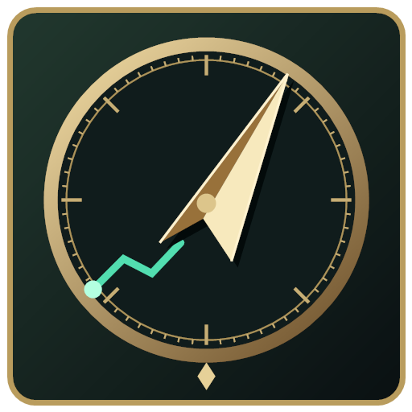

# Ruta Eorzea



Guía visual de navegación y misiones para **FINAL FANTASY XIV** mediante Dalamud y vnavmesh. Interfaz en español. **El personaje se mueve manualmente.**

## Qué hace

- Dibuja el camino transitable en el minimapa y en el mapa grande (**M**).
- Muestra una flecha y la distancia del tramo actual. Por defecto, la flecha sigue la dirección del siguiente tramo del rastro del minimapa.
- Añade casillas para seguir una misión principal o secundaria.
- Muestra el nivel entre paréntesis integrado en el título, con color según tu nivel actual.
- Permite **clic derecho en un punto o icono del mapa → Crear ruta hasta aquí**.
- Guía por salidas a pie entre zonas compatibles y vuelve a calcular el siguiente tramo al cruzar.
- Conserva la misión marcada al recargar y ofrece un engranaje de ajustes junto al minimapa.

## Instalar desde el repositorio

Requisitos: FFXIV para Windows iniciado con XIVLauncher y Dalamud, más **vnavmesh** activado. La compilación inicial está preparada para **Dalamud API 15**. Gubal es opcional para traducir el juego.

1. Instala vnavmesh siguiendo [las instrucciones de su autor](https://github.com/awgil/ffxiv_navmesh#installation).
2. En el juego escribe `/xlsettings` y abre **Experimental → Custom Plugin Repositories**.
3. Añade el índice público de este proyecto y guarda:

   ```text
   https://raw.githubusercontent.com/jorgestmerchant/RutaEorzea/main/pluginmaster.json
   ```

4. Abre `/xlplugins`, actualiza el catálogo, busca **Ruta Eorzea** e instálalo.
5. Espera a que vnavmesh termine de preparar la zona y marca una misión.

El índice, el icono y el ZIP de instalación son públicos y no requieren iniciar sesión. El flujo de publicación mantiene el índice actualizado cuando una versión termina de compilarse y publicarse correctamente.

### Si ya instalaste el ZIP de desarrollo

Desactiva la copia de desarrollo y quita **su ruta de Dev Plugin Locations** antes de instalar desde el catálogo. No cargues ambas copias a la vez. La configuración usa el mismo nombre interno, `RutaEorzea`.

### Actualizar

Una vez instalado desde el repositorio, las versiones nuevas aparecerán en el instalador de Dalamud. Actualiza desde `/xlplugins`; la instalación automática depende de los ajustes del usuario. No hace falta reemplazar archivos a mano. Un cambio sólo llega a los usuarios si la compilación, las pruebas y la publicación de esa versión terminan correctamente.

## Uso rápido

| Acción | Cómo hacerlo |
| --- | --- |
| Seguir una misión | Marca su casilla, junto al título. |
| Crear un destino | **M → clic derecho → Crear ruta hasta aquí**. |
| Abrir ajustes | Engranaje del minimapa o `/ruta`. |
| Detener la guía | Desmarca la misión o escribe `/ruta parar`. |
| Leer la misión del mapa | `/ruta mapa`. |
| Seguir la bandera nativa | `/ruta bandera`. |

**Ctrl + clic derecho** conserva la bandera del juego. La línea sobre el terreno viene apagada; puedes activarla en ajustes. Arrastra el panel de la flecha para moverlo.

Los niveles usan estos colores: **verde**, de 5 niveles menos a 2 más; **naranja**, 3 o 4 más; **rojo**, 5 o más; **gris**, 6 o más por debajo. El color compara niveles; no calcula EXP ni todos los requisitos de aceptación.

## Límites

- Es experimental: los parches del juego, Dalamud o vnavmesh pueden requerir una actualización.
- No todas las misiones ofrecen un objetivo compatible. En áreas de búsqueda se guía a un punto aproximado sobre suelo transitable cercano.
- Se admiten conexiones conocidas a pie. Transportes, vuelos, teletransportes y entradas especiales pueden requerir intervención manual.
- La distancia corresponde al tramo actual. El mapa grande sólo dibuja el camino del mapa actual.
- Los mapas con pisos superpuestos pueden ser ambiguos al elegir un punto personalizado.
- Las rutas personalizadas no se guardan al recargar; las misiones seguidas sí.
- La flecha alineada con el minimapa cambia con su giro. Si fijas el norte arriba, también respeta esa orientación. Puedes cambiar ese modo en ajustes.

Más detalles y comprobaciones: [LEEME.md](LEEME.md). Instalación manual alternativa: [INSTALAR.txt](INSTALAR.txt).

## Publicar nuevas versiones

El flujo de [GitHub Actions](.github/workflows/release.yml) se ejecuta al subir cambios a `main` o al iniciarlo manualmente:

1. Descarga las referencias públicas de Dalamud fijadas a una versión compatible.
2. Ejecuta las pruebas y compila el addon.
3. Asigna una versión de cuatro partes: versión base del proyecto más el número de ejecución.
4. Publica el ZIP en GitHub Releases.
5. Actualiza `pluginmaster.json` con esa versión, el icono y los enlaces al ZIP.

La primera ejecución requiere **Actions habilitado y permiso de escritura de contenidos** para el flujo. La protección de la rama debe permitir la actualización del índice por el bot; si se bloquea ese paso, el flujo falla y el catálogo conserva la versión anterior. No se necesitan tokens personales guardados en el proyecto.

Para compilar localmente con .NET SDK 10 y tu instalación compatible de Dalamud:

```powershell
dotnet build RutaEorzea.csproj -c Release -p:DalamudPath="RUTA_A_LAS_REFERENCIAS"
dotnet run --project tests/RouteMath.Tests.csproj -c Release
./tools/New-Package.ps1 -Repository jorgestmerchant/RutaEorzea
```

La [fuente del icono](tools/New-Icon.ps1) reproduce el estilo de la brújula del addon. No incluye recursos gráficos del juego. No se distribuyen las DLL de Dalamud ni los datos de FFXIV.

## Créditos

Proyecto de Jorge Merchant. Dependencias: [Dalamud](https://github.com/goatcorp/Dalamud), [vnavmesh](https://github.com/awgil/ffxiv_navmesh), [FFXIVClientStructs](https://github.com/aers/FFXIVClientStructs) y [Lumina](https://github.com/NotAdam/Lumina). Este proyecto no está afiliado con Square Enix.
